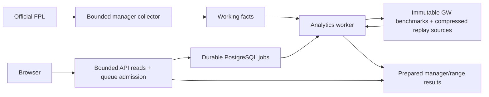

# Published My Trends analytics

Deployed to production on 22 October 2026. The API and SPA must be deployed in
the same release window: the former seven manager routes are replaced by
`GET /api/manager/:id/analysis?start=N&end=M`. There is no compatibility layer.

## Production acceptance record

- Architecture cutover: API `313d582`, SPA `eb89422`; both PM2 processes are
  running in fork mode and saved. Both additive migrations are applied.
- All seven GW publications have compressed replay input and reproduce their
  published calculations. An independent full source audit reconciled every
  selected squad with its GW score: 276,958 squads across GW1–7.
- GW6 initially had 12,743 mismatches among 40,000 sources. The entire bounded
  roster was refreshed from official history and picks using
  `node dist/database/repairBenchmarkSources.js --gw=6 --apply`, then rebuilt
  once with `ANALYTICS_REBUILD_HISTORICAL_FROM_FACTS=true`. The repaired
  generation is `3a2217a2-8ac8-4114-969e-d3b8f9feba3b`, with zero mismatches.
  Rebuilds now reject even a minority of known finalized score mismatches.
- Public HTTPS, fresh GW3–7 bundle, two waves of 20 concurrent requests:
  40 requests, median 269.84 ms, p95 359.76 ms, max 366.56 ms. All seven sections
  passed runtime validation. This is a prepared response check, not a cold-job
  or browser-render SLO. A separate canary read check during repair measured
  244 ms p95. Observed cold preparation jobs took about 0.7–1.1 seconds in the
  checked examples; upstream delays can be much longer.
- Production browser verification rendered My Trends and its comparison table
  without runtime exceptions, failed responses or horizontal overflow. Actual
  manager checks included a late entrant and all four chips. Full-season ranks
  matched official history in the checked examples.
- The 1,241,414,366-byte predeployment export was streamed off the server to
  the deployment workstation. SHA-256:
  `dfbd26c99d7f0bf1619f6c0d8c5f8647bb9261934eeb339ef4f7c82ff795d910`.
  PostgreSQL restored it successfully into `codex_fpl_production_restore_test`;
  verification found 5,210,282 managers, GW1–7 and no unvalidated foreign keys.
  This is a verified **one-time** export. Recurring off-server backups and
  backups of private deployment configuration remain unconfigured.
- After cutover and the restore drill, `ops/retire-legacy-aggregates.sql`
  reclaimed roughly 3.1 GiB by truncating only retired derived tables. Disk
  headroom increased from about 5.7 to 8.8 GiB. Original facts and the verified
  predeployment export remain available; legacy rollback requires restoring
  or rebuilding its aggregates.
- The v5 seeded sampler successfully collected its initial 1,000 managers with
  no fetch failures. Its replacement GW7 draw continues through the resumed
  15-minute cron. Until that draw is complete, the previous usable GW7 publication
  is retained. `sample_finalized=false` is expected during that transition.
  Production runs are tuned to 10,000 managers (2,500 / 2,500 / 5,000 budgets)
  so the three upstream fetches per manager fit the 30-minute cron watchdog.
  Lock cleanup checks the owning PID before removing a replacement run's lock.
  Enqueueing benchmarks remains allowed during a bulk refresh; only their
  calculation waits. This prevents successful sample collection from being
  reported as failed merely because bulk publication is in progress.
- `ANALYTICS_PRUNE_WORKING_FACTS=true` is configured after the archive/export
  audit. Its guard defers cleanup until the latest replacement sample and all
  finalized replay archives are complete, then removes at most 500 obsolete
  managers per maintenance pass. Do not bypass that guard.
- Bulk and rank-curve cron are restored. The bulk helper refreshes hourly when
  idle and every five minutes during live matches; its cron wrapper uses flock
  and a 15-minute timeout. Readiness/disk probes run every minute;
  unprivileged log rotation runs hourly for PM2 and collector logs. Probe results
  are in `/home/deploy/analytics-monitor.log`. External alert delivery is still
  unconfigured. Readiness returned HTTP 200 after cutover.
- The owner role has 60-second statements, two-second locks and 8 MiB work_mem
  defaults. Read-pool deadlines remain stricter. The Prisma pool is capped at
  four connections. Creating a restricted read role and setting temp_file_limit
  still require a database administrator; the deploy account has no sudo or
  PostgreSQL superuser access.
- A full bulk-refresh smoke test exposed an unbounded fixture upsert queue
  against the new four-connection Prisma pool. Fixture publishing now uses
  atomic 500-row batches, removes stale natural player/fixture keys correctly,
  and preserves postponed schedules as NULL. A session advisory lock serializes
  HTTP and cron refreshes before they touch shared raw files. Integration tests
  verify stable IDs, idempotency, rollback after a later batch fails and lock
  release after errors.
  The corrected production refresh completed at 16:33:48 UTC with 20,708
  fixtures, cleared the bulk guard, advanced the refresh revision and restored
  HTTP 200 readiness. A competing admin refresh returns 202 without invalidating
  the previously served bulk cache.
- Latest release validation passed 84 tests with no skips, backend lint and
  contract drift checks, both type checks and production builds. Source-buffer
  copies are released before calculation to reduce late-season worker memory.
  The full 38-GW SQL path still needs capacity testing beyond the synthetic
  CPU/heap check; do not interpret the current rollout as that load test.

`check-local-state` now inspects publications, replay sizes, jobs, sampling state
and PostgreSQL limits without scanning the legacy population or asking operators
to rebuild retired cumulative tables. Manager resets retire current-season jobs,
publication pointers and caches atomically, preserving immutable replay archives.

## Serving and preparation

The API reads publication IDs, one prepared result and a job status. It neither
scans sampled manager history nor calls FPL. A new manager/range returns 202 and
the UI polls for preparation. Cold preparation still depends on FPL latency;
moving that work to a worker does not make upstream calls instantaneous. Ready
results expire after five minutes (30 seconds for partial results), and stay
available during refreshes. A failed refresh stops rapid polling and exposes
an error with a manual retry. Each section records its own successful timestamp.

The separate read pool has four connections, a 1.5-second acquisition limit and
a two-second PostgreSQL statement deadline. Queue admission limits pending work
to roughly 2,000 total jobs and three per manager (concurrent admissions can
slightly exceed these soft limits). Existing IP limits remain in force. One
worker claims jobs with `FOR UPDATE SKIP LOCKED`, renewable leases, token-fenced
publication and bounded retries. Dependency waits do not consume retry attempts.
CPU work yields between range calculations so lease renewal remains responsive.
Manager fetch clients share a Retry-After cooldown after an FPL 429; the worker
continues DB-only benchmark jobs while postponing new manager hydration.

Benchmarks are keyed by season/GW/calculation version. Publishing inserts an
immutable generation and changes its pointer in one transaction. A manager job
pins every required GW generation. The response revision also includes the bulk
refresh version. Bulk writes block new calculation work until they complete;
a failed bulk write leaves the guard active until a successful populate rerun.
If PostgreSQL can still read but rejects refresh writes (for example, disk
exhaustion), the API serves the saved bundle with a refresh error; a cold lookup
returns a typed failure. Older prepared results remain readable. Two benchmark generations per GW are
retained. Manager caches retain the latest 20 ranges after a ten-minute grace
period, and expire abandoned results after seven days. Increment `CALCULATION_VERSION` when changing published mathematics,
then republish all GWs and regenerate manager results.

## Definitions and accuracy

### Fixed Top 10k follow-up cohorts

When the end-of-range sample is too thin, an idle finalized manager-ingest
pass can follow a deterministic sample of 300 managers from the archived
Top 10k at the start of a range. It only selects from an archive containing
10,000 distinct stratum-1 managers with valid Top 10k ranks. This is a strict
availability gate, not proof that legacy collection had no selection bias;
ties at the cutoff and historical source provenance remain limitations.
The selection is fixed before looking at subsequent results. At least 297 of
the 300 selected entries must be available; only FPL 404s count as permanent
nonresponse. Other upstream errors defer the job. History must cover the range
and ordinary transfers are reconciled within the selected range. Score and
chip estimates remain available if some transfer logs are incomplete, but the
transfer value requires at least 297 reconciled logs. Successful fetches are cached for
seven days so interrupted work can resume. The selected IDs and observations
are saved in the immutable compressed benchmark replay input.
Each benchmark also stores a small materialized copy of the follow-up input,
so refreshing the current GW does not decompress its complete replay archive.

One missing range is prepared per idle collector pass, prioritizing the latest
finalized end GW. The collector waits up to three minutes for queued work to
finish and requires at least 1.2 GiB of available memory before starting.
`MANAGER_TOP10K_FOLLOWUP=false` disables automatic collection.
An operator can also run `npm run analytics:follow-top10k -- --start=4 --end=8`
for a specific finalized range; coordinate this manual command with manager
ingestion to avoid extra upstream load. Collection makes two FPL requests per
uncached entry and uses a 100 ms pause after each. Benchmark calculation and
publication happen in the background; the public handler still reads prepared
results. Compare prepared-read and cold-job latency under production load
before claiming there is no operational impact.

Calculation version 2 must be rebuilt for every published GW using
`npm run analytics:benchmarks`; the existing worker processes the queue. Set
`MANAGER_TOP10K_FOLLOWUP=false` before rollout and restore it after the checks
below. During
the version transition older saved analyses can be served stale while missing
benchmarks are rebuilt. Verify the queue, every GW publication, replay, source
coverage and API latency before enabling the follow-up collector. Historical
ranges whose anchor archive does not pass the census gate remain unavailable;
the system does not fabricate a sample for them. The new path does not capture
future standings independently, so incomplete future anchor archives will also
remain unavailable until a separately verified capture mechanism is added.

- Stored manager GW points are **net of transfer hits**. All comparison score
  means use that definition. The old rounded official gross GW average is no
  longer mixed with a manager's net total.
- Source sampling weights are `stratum population / observed source managers`:
  top 10k, next 90k, and the remaining ranked population. Top 10k/100k range
  cohorts use rank immediately before the range; ranges starting at GW1 use
  end-of-range rank. A missing previous rank does not imply elite membership.
- Range rank uses a weighted score histogram, including negative scores and
  tied-score midranks. Full-season ranges prefer the official FPL rank. A missing
  populated source stratum makes a sample estimate unavailable. Late entrants
  contribute their played GWs; missing internal history does not become zero.
- EO uses the full XV and actual FPL multipliers, including promoted vice,
  Triple Captain, Bench Boost, autosubs and bench zeroes. Ratios retain floating
  precision; Kish effective sample size is a coverage gate, never a surrogate
  population denominator. Thin band samples use explicit, flagged fallbacks.
- Captain bonus is raw player points times `max(multiplier - 1, 0)`. Intended
  captain choice is a separate statistic. Captain benchmarks and most-captained
  frequencies combine independent per-GW source cohorts; they do not require a
  manager to appear in every historical sample. Other range comparison rows use
  the fixed range cohort described above. A representative TC multiplier is
  `2 + TC share / (ordinary captain share + TC share)`.
- **Raw pts / transfer** is the mean per manager of IN-minus-OUT player points
  from each transfer GW through range end, excluding Wildcard/Free Hit
  transfers, lineup/captain assumptions and hit costs. The user and sample use
  this same formula. Detailed Transfer Impact retains its distinct, labelled
  counterfactual lineup/holding-window model.
- Rank-place effects retain the nonlinear score-to-rank curve. Per-GW values
  are contributions to the selected range's ending-rank counterfactual, not
  independently observed daily rank changes. Finalized squad points are checked
  against the official net range score. Finalized sampled squads are independently
  reconciled before they contribute to EO/captain benchmarks; insufficient valid
  coverage prevents final publication. A mismatch fails the personal section rather
  than publishing a plausible wrong total.

Zod validates FPL payloads and the complete API response. `contracts:generate`
derives both repositories' schemas from exported backend response types;
`contracts:check` detects drift. Missing metrics remain nullable and the UI
displays unavailable/error states. Schema changes fail explicitly. Good sections
from an earlier result survive a partial refresh failure, with earlier timestamps.

The sample is capped at 40k per GW: 10k/10k/20k managers. New collection uses a
seeded, resumable permutation of standings pages, with a frozen population frame
for that GW. This is **page-cluster sampling**, not independent Bernoulli draws.
Historical legacy samples have churn/provenance limitations; capping and weighting
them cannot retrospectively eliminate selection bias. Historical nonresponses,
live population changes and a light rank band remain limits on estimates.

`analytics:calibrate -- <generation UUID>` performs a deterministic 80/20 cluster-held-out
full-season rank audit and reports median/mean/p95 absolute rank error. New
samples retain their source standings page. Legacy rows without that provenance
use inferred rank blocks, reported explicitly as inferredClusters; their reports
need extra caution. It does
not certify arbitrary-range accuracy or provide cluster-aware confidence
intervals. There is no public census answer for arbitrary partial ranges. The UI
therefore labels its bar **sample coverage**, not numerical accuracy. Run and
retain calibration reports on representative production snapshots before rollout.

## Validation and release sequence

1. Review both repository diffs together. Run `npm ci`, backend `build`, `lint`,
   `contracts:check`, `test`, and frontend `typecheck`, `lint`, `build`. Release validation passed all 84 tests with no skips, both builds and type
   checks, backend lint and frontend lint (which retains pre-existing warnings).
   The new CI
   job provisions PostgreSQL 16 and executes the migration/integration tests.
   Locally, integration tests require `ANALYTICS_TEST_DATABASE_URL` naming a
   dedicated database ending in `_test`, with the existing schema migrated.
2. Acquire a restorable database export before destructive cleanup. The release
   export passed a workstation restore drill; **recurring off-server backups are
   not active**. Ongoing protection against complete disk/host loss is pending.
3. Pause manager cron for the initial publication window. Apply the two new
   migrations (`npm run migrate`); neither rewrites or deletes existing facts.
   Build the backend, then run `npm run analytics:benchmarks` to enqueue every
   played GW. Run a single analytics worker, observe memory, disk headroom, query
   temp files and leases, then validate every publication.
4. Replay a generation for every GW with `analytics:replay -- <UUID>`. Run held-out
   audits and compare known manager IDs/ranges against official score history,
   prior trusted results and manual examples. Historical data defects can require
   targeted backfill. Do not interpret the synthetic test as a production pilot.
5. Configure the optional restricted read role from `ops/postgresql-roles.sql`
   and `ANALYTICS_READ_DATABASE_URL`. Apply role limits with an administrator;
   migrations must continue using an owner role. Limit the worker Prisma pool
   using the URL parameters shown in `ops/analytics.env.example`.
6. Start/reload `ops/ecosystem.config.cjs` from the API repository root, deploy
   the SPA built with `API_BASE_URL=/api`, resume cron with the bounded sampler,
   and watch readiness and request/job timings. Both PM2 process names must be
   saved with `pm2 save`. The worker has a separate heap/restart limit; tune only
   after measuring the full SQL-to-publication path on the 4 GiB host.
7. Roll back both application releases together if needed. New tables are
   additive. After retiring legacy aggregates, rebuild or restore them before any
   legacy rollback. After source pruning, rollback needs replay/FPL hydration or a
   restored export; do not switch back to the old population-scanning endpoints.

`analytics:benchmark` is an isolated CPU/memory smoke test for 40k managers × 38
GWs; it includes all 38 start-range keys. It is not a production SQL load test.
Local integration prepared reads measured roughly 90–180 ms p95 with 20 concurrent
requests; the budget asserted by the test is 2 seconds. These figures do not
predict Hetzner latency. The production acceptance record above distinguishes
prepared public HTTPS timings from cold jobs and the original endpoint trace.

## Retention, failures and recovery

Normalized replay input is gzipped in `analytics_benchmarks.source_payload` and
checksum-verified during replay. Finalized historical rebuilds replay this frozen
source instead of using a fragment of a retired roster. Rebuilding historical
source facts requires explicit ANALYTICS_REBUILD_HISTORICAL_FROM_FACTS=true and
a complete restored/backfilled roster; never use that switch after pruning only
a subset of managers. It preserves repeated transfer operations that
the legacy relational PK could merge. Storage scales with the bounded sample,
not millions of refreshed accounts. It is **inside PostgreSQL**, so it is replay
input and not an independent backup.

`analytics:prune` defaults to a dry run. `--apply` removes at most 500 obsolete
working managers, preserving the current finalized sample and recently prepared
users. It refuses to run unless every played GW has a finalized generation with
retained source input. Enable recurring batches with
`ANALYTICS_PRUNE_WORKING_FACTS=true` only after the release audit and a verified
recoverable archive. Initial legacy cleanup can take many batches; monitor WAL
and autovacuum. DELETE does not shrink files immediately. Do not run VACUUM FULL
on the nearly full production disk; arrange headroom for any rewrite separately.
Offline legacy builders remain in source for recovery; their derived tables
were emptied after cutover. Cron and the manager API no longer use those tables.

Structured logs include request IDs, normalized routes, status, duration, job
kind, retries and section failures. `/api/health/live` checks the process;
`/api/health/ready` checks the DB, publications, heartbeat, queue delay and recent
unexpected job failures. Collector success age is included for monitoring.
Install `ops/pm2-logrotate.conf` with the appropriate production log path. Run
`bash ops/monitor.sh` from an OS monitor and configure an **external uptime monitor**
for host-down alerts; recent partial results also degrade readiness. Local probes
and rotation are installed; external alert delivery is not configured.

Once an SSH-accessible off-server destination exists, configure
`ops/backup-offsite.sh` with libpq credentials, a restricted SSH user and an
existing destination directory. It streams a consistent compressed `pg_dump`
directly to that host, checks the transfer and records completion; no dump is
staged on the production root disk. Schedule daily, retain multiple dated copies
on the destination, and enable `REQUIRE_OFFSITE_BACKUP=true`. Daily dumps imply
up to a day of data loss; use WAL archiving/physical backups if a smaller RPO is
required. PostgreSQL's [SQL dump documentation](https://www.postgresql.org/docs/16/backup-dump.html)
describes the consistency guarantee and the separate need to preserve roles.

`ops/restore-drill.sh` verifies the remote checksum and restores into a **new**
`*_restore_test` database; it never drops an existing database. Run replay,
calibration and API smoke checks against the restored database before calling a
backup verified. Preserve role definitions, configuration and private credentials
separately. [pg_restore](https://www.postgresql.org/docs/16/app-pgrestore.html)
provides `--exit-on-error`; the drill uses it. Backup/restore scripts need Linux
operational testing with the eventual storage host; that cannot be validated
without a destination. PostgreSQL [resource limits](https://www.postgresql.org/docs/16/runtime-config-resource.html)
complement the application timeouts and disk preflight, but do not replace a
backup or prevent every PostgreSQL failure.
