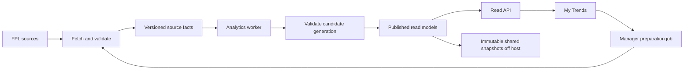

# My Trends backend redesign: diagnosis and implementation plan

Date: 22 October 2026. Status: proposal; no application or production changes.

## Recommendation

Rebuild the manager analytics pipeline and its read contract while retaining
Node, TypeScript, Express, and PostgreSQL. Use a modular backend with separate
API and worker processes. PostgreSQL remains the system of record; expensive
population calculations belong in workers and published read models.

The primary invariant is: **an HTTP read must never scan the manager population,
rebuild a missing aggregate, or synchronously hydrate a manager's season from
FPL.** It reads an explicitly published generation, a bounded set of manager
facts, and small shared benchmarks. A previously unseen manager requires an
observable background preparation job.

Improve four things together: query cost, sample size and retention, publication
correctness, and operational recovery. Precomputation alone moves the current
cost to cron; it does not make the ingestion architecture sustainable.

## Investigation scope and evidence

Reviewed the frontend request flow, manager endpoints and calculations, Prisma
schema and indexes, ingestion and rebuild code, cache, health endpoint, tests,
season lifecycle, and October incident/recovery records. Inspected the archived
comparison optimization's change summary. Production checks used existing SSH
access and read-only PostgreSQL transactions with 4-5 second statement limits.
No load test, population count, EXPLAIN ANALYZE, rebuild, migration, cleanup, or
configuration change was performed on production.

Both repositories were clean at the start. Local backend and production were
at `8b2d8b5`. The archived precomputation work is
`origin/archive/my-trends-precompute-20261021`, commit `0836ec8`; it is not the
production implementation.

### Production snapshot, approximately 13:35-13:39 Europe/Warsaw

These observations are a point-in-time audit while ordinary traffic and cron
were running, not a stable benchmark. Relation sizes include indexes. Row counts
below are planner/statistics estimates, not exact counts.

| Item                        | Observed value                                                                            |
| --------------------------- | ----------------------------------------------------------------------------------------- |
| Host                        | About 3.8 GiB RAM; 38 GB root filesystem; approximately 6 GB available, 84% used          |
| PostgreSQL                  | 16.15; accepting connections; database approximately 20 GB                                |
| `manager_summary`           | Approximately 5.19 million live rows; 701 MB                                              |
| `manager_history`           | Approximately 13.92 million live rows; 2,181 MB                                           |
| `manager_cumulative`        | Approximately 13.95 million live rows; 2,976 MB                                           |
| `manager_transfers`         | Approximately 63.80 million live rows; 8,212 MB                                           |
| `manager_pick_elements`     | Approximately 41.03 million live rows; 5,532 MB                                           |
| Cumulative churn            | Approximately 1.86 million estimated dead tuples                                          |
| PostgreSQL temporary writes | Approximately 30 GB cumulative in database statistics; this is not current disk occupancy |
| API database role           | Default `statement_timeout=0`, `lock_timeout=0`; `temp_file_limit=-1`; `work_mem=64 MB`   |
| Query observability         | `pg_stat_statements` extension absent                                                     |
| Manager sample              | GW7; cleaned GW7; finalization state 2, meaning finished-GW collection in progress        |
| Rank curves                 | GW2-7 snapshots present; GW1 absent; GW6 snapshot still marked non-final                  |

The audit session temporarily set its own statement timeout. Its reported
`reset_val=0`, rather than that temporary session value, establishes the role's
default statement timeout.

Existing application queries were observed running for 37-99 seconds. Their
prefixes identified comparison cohort aggregates and the shared
`same_gw_sampled_rows` captain query. Some waited on data reads or shared buffer
I/O. This confirms continuing database work during the audit without adding new
expensive requests.

Transfer aggregate coverage was incomplete: GW6 had only range 1-6, with ranges
2-6 through 6-6 absent. GW7 had only 1-7 and 2-7 at that instant during a rebuild.
The latter can be transient; the API has no generation manifest that distinguishes
an unfinished publication from a complete one.

The October 21 record documented PostgreSQL being down, extreme disk pressure,
and a rebuild blocking readers behind a transactional TRUNCATE. The original
PostgreSQL shutdown cause remains unconfirmed without the protected historical
logs. Do not turn the disk-pressure evidence into a claim that corruption or
one particular optimization caused the original shutdown.

Relevant records:

- [Production outage](2026-10-21-production-database-outage.md)
- [GW7 recovery](2026-10-22-my-trends-recovery.md)
- [Comparison performance investigation](my-trends-comparison-performance.md)
- [Archived optimization and deployment decisions](2026-10-21-change-review.md)

## Diagnosis

### 1. Read models exist, but hot paths bypass them

`comparisonCohorts.loadComparisonCohorts` constructs cohorts using pre-range
ranks, joins end/start cumulative facts and history, groups history per manager,
and then groups the population by stratum. Its captain-choice query separately
joins and groups sampled picks. This is real population work per cold range.
The older constant-size `sampleStratumAggregates` helper still exists, but the
main comparison response uses the newer, expensive causal cohort path.

`rankImpact.fetchCaptainRatesInRankBand` joins sampled captain rows, source
stratum weights, historical ranks, and gameweek populations. Both team and
captain impact call it. Captain impact calls it twice for different bands and
also requests the identical population-wide captain rates twice. The shared
query does not have a published read model or cross-endpoint single-flight.

`getCaptainImpact.fetchTop10kCaptainByGw` is another raw picks/history aggregate.
`rangeStats` can build rank curves from large manager tables when snapshots are
missing. Its density helper also queries cumulative rows even where the caller
ultimately uses a separate curve for rank movement.

The screenshot's roughly 36-second team and captain times are consistent with
their shared dependency. Tracing is still needed to assign exact percentages
to SQL execution, connection waits, FPL fetching, and contention.

Sources: [comparison cohorts](../src/managers/comparisonCohorts.ts),
[rank impact](../src/managers/rankImpact.ts),
[captain impact](../src/managers/getCaptainImpact.ts),
[range statistics](../src/managers/rangeStats.ts).

### 2. Sampling and storage lifecycles are different concepts today

Current defaults bound the standings walk per GW to approximately 10k Top 10k,
90k next-90k, and a 50k tail target. That is already more collection than every
metric necessarily needs. Membership can change each week, and old managers,
full histories, transfers, and squads remain in the database. The existing
millions of managers also reflect earlier ingestion behavior; current defaults
alone do not explain all accumulated rows.

There is no explicit season-long storage budget or retirement policy for old
sample membership. A cap on managers per run or per GW does not cap historical
storage. Sampling provenance is recorded for some picks, but histories and
comparison selection do not consistently use a frozen sample design and known
inclusion probabilities.

The schema describes full XVs as lazy user data. In reality, ingestion persists
full XVs for sampled managers as well. Transfers and picks occupy approximately
13.4 GB together, and their indexes account for substantial space.

Twenty GB is a manageable PostgreSQL database. The problems are resource
headroom, repeated broad reads, write amplification, and absent lifecycle rules;
the observed size does not establish a need for a different database engine.

Sources: [schema](../prisma/schema.prisma),
[ingestion](../src/database/populateManagers.ts).

### 3. Ingestion repeatedly rewrites historical data

Every processed manager upserts all returned history rows, then deletes and
reinserts their cumulative rows. Changing a mutable summary stratum also rewrites
historical cumulative classification. This generates avoidable WAL, dead rows,
index updates, and vacuum work as the season grows.

The current-GW exposure hotfix bounded one formerly global rebuild and was useful:
the recovery record reports 283 seconds falling to approximately 6-8 seconds.
However, running statistics and captain aggregates still rebuild broadly, while
transfer averages repeat a large transfer/history aggregate for each range
ending at the latest GW. The same recovery record reports a 957-second transfer
average refresh. Running that behind the main ingestion loop consumes much of
the 30-minute job allowance and competes with serving requests.

Some PK-prefix indexes may be redundant; other indexes have low recorded usage.
Usage counters are not proof an index is unnecessary. Validate plans, uniqueness,
foreign-key needs, and representative query coverage before removing indexes.

### 4. Publishing is not an atomic product operation

Read models are rebuilt sequentially, so cards can observe different input ages.
Some rebuilds still TRUNCATE their table. The transfer-average rebuild deletes
the latest end-GW slice before filling it range by range in separate statements.
The comment calls this a 1-3 second gap; observed job timings show why that is
an unsafe assumption.

Finalization metadata can be written before all read models rebuild. A caught
rebuild failure logs an error and permits the run to finish. The outer manager
job catch also logs without guaranteeing a nonzero process exit. The disk guard
exits successfully when withholding ingestion. Scheduler success therefore does
not imply fresh, complete analytics.

The live-to-final transition deletes the current GW's data before recollecting
it. Readers lose the previous useful snapshot during that process.

### 5. Caches hide cost and do not define consistency

Responses have a five-minute process-local cache. Cohorts have a separate
range-keyed cache. Manager keys omit season, published generation, and calculation
version. Direct cron publication does not immediately invalidate those keys.
The summary/history fetch maps expire entries when those same IDs are accessed
again, with no overall cardinality cap.

Browser aborts do not cancel PostgreSQL work. nginx or Axios timing out can leave
queries competing with the next range request and its automatic retry. The
frontend starts seven manager requests in parallel, including hidden captain
content. The slider already commits changes on release; adding debounce alone
would not solve this.

Range-rank and comparison sections render only while pending or when data exists.
An initial error can therefore remove a section without an explanation. Other
sections have explicit errors, so failure behavior is inconsistent across the
same page. Retain the last usable data, identify the failed section, and expose
a targeted retry and useful freshness status.

Sources: [response cache](../src/cache/responseCache.ts),
[manager fetch cache](../src/managers/fetchManager.ts),
[My Trends route](../../fpl-trends-app/src/components/MyTrends/my-trends.route.tsx).

### 6. There are concrete semantic and freshness risks

These need independent examples and regression tests before carrying formulas
into a replacement:

- **Transfer comparisons use different definitions.** Sample averages sum raw
  IN-minus-OUT points through range end. The user calculation handles subsequent
  ownership windows, squad changes, Free Hit, hit costs, and starter heuristics.
  The transfer endpoint itself deliberately returns a null per-transfer average;
  the comparison endpoint uses the user net/count wrapper. These are not yet a
  coherent metric specification. Choose a comparable definition or explicitly
  present different metrics.
- **Captain selection differs across paths.** Comparison and ingestion derive a
  captain from `is_captain`; captain impact searches for the effective highest
  multiplier. Reproduce vice promotion and double-no-show payloads to establish
  expected intended-choice versus effective-bonus behavior in every endpoint.
- **Picks can remain stale or incomplete.** `resolvePicks` treats any persisted
  row for a GW as a cached GW, does not require a complete XV, and has no general
  live/final source version. An unsampled user's first live snapshot can be reused
  after final autosubs unless another path refreshes it.
- **Missing strata can still yield a rank number.** `estimateWeightedMidrank`
  sums available strata without requiring every nonempty population stratum.
  Checking only the user's stratum does not establish a population estimate's
  completeness. Captain aggregation already has a stricter missing-stratum rule.
- **Historical status is too coarse.** Older end-GWs are reported final by
  freshness logic without verifying all their required read models exist.
- **Changing populations invalidate naive prefix subtraction.** Subtracting sums
  for two different manager sets or stratum memberships does not produce a valid
  range statistic. An ever-present boolean is also insufficient to establish
  complete coverage throughout a range.
- **Missing and zero are sometimes conflated.** A missing match history row needs
  source coverage/fixture state before it can safely mean a blank GW or zero.
- **Some semantics are inherently estimates.** Effective ownership fallbacks,
  counterfactual transfer starter rates, and player rank attribution require
  explicit assumptions. Individual nonlinear rank counterfactuals do not generally
  sum to the manager's actual rank change.

These are findings from code, not a claim that every affected manager response
has already been reproduced against FPL.

### 7. Guards and tests exist, but do not establish reliability

The backend already has rate limiting, an admin guard, health checks, a fetch
governor, a disk guard, and focused regression tests. The API AGENTS notes about
absent endpoint rate limiting are stale. Existing health checks cover database,
bulk data shape, and penalty-feed coverage, but not complete manager read-model
coverage or successful publication. An old timestamp can still pass.

Local `npm test`: 50 passed, 0 failed, 1 PostgreSQL integration test skipped because
its opt-in test URL was absent. Most tests check helpers or mocked reads. There
is no complete independent reference model, broad SQL integration suite,
population-estimator calibration, or latency/failure regression suite in the
reviewed tree.

The current accuracy meter uses sample counts against fixed targets. It is a
coarse coverage indicator, not an empirically calibrated confidence interval.

## Target design

### Data flow and process boundaries

Use one repository and a small number of deployable processes. Split the current
large ingestion module into source clients, sampling, canonical facts, pure
calculations, read-model builders, publication, jobs, and HTTP presentation.
Keep numerical rules independent of Express and Prisma. Generate or share API
schemas/types across the two apps instead of maintaining parallel handwritten
interfaces.

The worker can initially use PostgreSQL jobs with idempotency keys, leases,
heartbeats, bounded retries, and failed-job records. Cron can enqueue scheduled
work; it should not be the only record of whether work completed. Keep API and
worker connections/resource budgets separate. A durable queue remains necessary
even though its database can itself be temporarily unavailable.

### A. Explicit source facts and sample membership

Use season in all natural identities. Separate observed data from estimates:

- Player fixture facts and a compact `player_gw_stats`/points-prefix read model.
  Keep per-fixture facts for DGWs and explainability; aggregate points once.
- Manager GW facts: gross points, hit cost, net points, official cumulative
  points/rank, chip, transfer count, and data-completeness state.
- Manager GW squad snapshot: intended captain/vice, effective scoring
  multipliers, and source state/timestamp. Store and validate a complete snapshot
  atomically; live facts can receive a corrected revision.
- Transfer events preserving source order/time and stable source identity where
  available. The existing `(entry, gw, in, out)` key may merge repeated same-GW
  operations; verify actual source payloads before selecting the replacement key.
- `sample_membership`: season, sample design/revision, GW or cohort anchor,
  entry, selection stratum, inclusion probability, source capture interval,
  eligibility, and collection/completeness state.
- `manager_sync_state`: requested-manager activity/retention and successful
  coverage per endpoint, separate from population sample membership.

Retain compressed accepted source payloads off host, addressed by content hash
and capture metadata. Keep the references needed to replay published results.
Validate runtime payloads, including nullable upstream fields and unknown chips.
Final data is stable by default but remains correctable through explicit revisions.

### B. Bound sampling by the question being answered

Start by evaluating a roughly 20k representative global panel plus approximately
10k Top 10k and 10k additional elite sample slots per GW. These are pilot budgets,
not promised statistical accuracy. Distinct membership can overlap. Allow a
smaller explicitly nested transfer-analysis sample if that feature needs it.

The global panel should remain longitudinal where practical, with a documented
refresh design for late entrants and attrition. Elite comparison and per-GW
ownership samples have separate membership lifecycles. Do not treat a convenience
union of all managers ever visited as a probability sample.

Use randomized selection with reproducible seeds and known probabilities from
the ranked population; account for page clustering if sampling whole standings
pages. Eligibility, nonresponse, overlap between sample sources, and live
standings movement need explicit weighting rules. A statistician-style validation
of these rules is part of the reference-model work.

For later ranges, freeze comparison membership at `start_gw - 1` if the question
is "how did managers who were Top 10k before this range perform?" Preserve the
current descriptive end-rank semantics for GW1 ranges only with clear labels.
Per-GW "near you" EO uses the prior-GW band; it is a different benchmark from a
cohort frozen at the beginning of a multi-GW range. Population range rank uses
the eligible population at range end, with defined treatment of late joiners.

Frozen range-start cohorts require follow-up after managers leave an elite band.
Allocate separate bounded longitudinal subpanels for this purpose, with fixed
membership, selection weights, and per-start-GW budgets. Following every member
of a rotating weekly elite census for the rest of the season would recreate
growth. Count these follow-up slots and any historical hydration separately from
the per-GW EO budget. Validate whether affordable subpanels support the desired
elite comparison accuracy before committing to sample sizes.

Sample size increases only when holdout error warrants the additional cost.
Large samples do not correct biased selection or inconsistent metric definitions.

### C. Publish shared read models with explicit keys

Every key below also includes season, calculation version, and published
generation or a dependency manifest identifying compatible source revisions.

| Read model                     | Main key                                           | Use                                                                                   |
| ------------------------------ | -------------------------------------------------- | ------------------------------------------------------------------------------------- |
| Comparison range stats         | cohort definition, start GW, end GW                | Weighted sums/counts, coverage, transfers/hits/bench/chips and agreed captain metrics |
| Captain rates/choices          | prior-rank band, GW, player                        | Intended-choice frequency and effective captain/TC bonus as distinct measures         |
| Player exposure                | prior-rank band, GW, player                        | Squad, active and effective-multiplier rates; weight sums and effective sample size   |
| Range score distribution       | sample design, start GW, end GW, score             | Weighted range-rank CDF, ties, coverage and uncertainty inputs                        |
| Overall score/rank curve       | GW, capture/revision                               | Coherent live or final curve; eliminate request-time population fallback              |
| Transfer benchmark             | metric definition, frozen cohort, start GW, end GW | Comparable per-manager numerator/denominator and observed coverage                    |
| Manager analytics facts        | entry, GW/source revision                          | User-only calculations, normalized once by the worker                                 |
| Bounded manager response cache | entry, start GW, end GW, dependency versions       | Frequently viewed prepared responses; evictable derived data                          |

There are only 741 contiguous ranges in 38 GWs. Three scalar comparison strata
produce 2,223 range rows per generation. That makes shared scalar precomputation
attractive. Histograms and per-player data have extra score/player dimensions;
they need their own measured size and build budgets.

Avoid materializing every manager times every range. Small per-user sums and
rank-curve interpolation can run at read time over bounded facts; more complex
per-user outputs can be worker-prepared or cached only when requested.

Use per-manager prefix subtraction only for additive quantities with the same
member set, explicit anchors and range completeness counters. Derive cohort
statistics from that frozen set before aggregating. Store denominators and weight
sums, not averages alone. Transfer ownership/counterfactual windows and nonlinear
rank movement require their own algorithms rather than naive prefix subtraction.

### D. Build candidate data, validate, then publish

1. Record the accepted source revision and exact sample membership.
2. Build changed facts/read-model slices into a candidate generation while the
   prior generation remains readable. Use short, bounded batches.
3. Validate expected range/GW/cohort coverage, source dependencies, sample quality,
   and domain invariants. Explicitly unavailable metrics carry a reason.
4. Atomically change a small published-generation pointer after required checks.
5. API requests pin that generation; frontend cards share an analysis context so
   independently fetched sections cannot silently mix generations.
6. Retain the prior healthy generation for rollback; garbage-collect retired
   generations under a bounded retention policy after readers have released them.

Separate fast/live publication from slower transfer analysis through a declared
dependency manifest if needed. Each section exposes its own source age; the UI
must not imply all sections share one timestamp when they do not. Publish
collection/finalization status only after the corresponding validation succeeds.

A failed job leaves the previous generation available and records failure. A
live-to-final transition builds the replacement alongside the live generation.
Missing read models result in a declared state and repair job, never a large
fallback query in the HTTP handler.

### E. Make HTTP reads predictably bounded

For a prepared manager, read compatible manager facts and shared benchmarks,
perform small deterministic calculations, and return section results with
`season`, `generation`, `calculation_version`, source timestamps, coverage,
`provisional/final/stale/unavailable`, and structured reason codes.

For an unseen or stale manager, enqueue one idempotent preparation job. Return
the last usable result with freshness metadata, or HTTP 202 with job status and
`Retry-After`. The UI can render ready sections and poll for the rest. A 202
response is preparation status, not a completed analytics result. Invalid IDs,
upstream failures, queued work, and insufficient statistical coverage are distinct.

Use a shared analysis context or a small overview response to avoid seven
independent preparations. Preserve progressive rendering and independent section
errors; a monolithic response waiting for the slowest section would recreate a
page-level bottleneck. Prioritize visible sections; fetch hidden captain detail
when selected or during bounded idle prefetch.

Cache keys include season, manager fact revision, benchmark generation, metric
version, and range. Bound all in-memory caches and in-flight work. Use stable
ETags for finalized revisions and short revalidation for live revisions.

Propagate deadlines into SQL and upstream work. For shared work, cancel only
when no interested caller remains; a single disconnected subscriber must not
cancel another subscriber's result. Background jobs have separate deadlines.

### F. Bound collection and recomputation

- Upsert changed facts in batches. Detect changes by source revision/hash and
  avoid touching unchanged historical rows.
- Compute cumulative facts from the earliest changed GW forward, rather than
  deleting a manager's entire cumulative season on every visit.
- Rebuild only dirty GW/cohort/end-GW partitions. Corrections to old player
  points, ranks, or sample membership invalidate all affected dependent ranges,
  not just the current GW.
- Build the ranges for an end-GW in a bounded batch over reusable facts instead
  of repeating a full source-table scan for each start-GW. Measure the total
  worker cost as well as read latency: 741 small output keys do not imply that
  computing those outputs is cheap. Store incremental contributions where their
  metric semantics permit it.
- Capture live rank curves on their own cadence, as the existing system already
  begins to do. Bound the live sample separately from final-season collection.
- Give user-requested preparation higher priority than long historical backfills.
  Limit total upstream concurrency across API preparation and scheduled work.
- Checkpoint progress, retry transient failures with jitter and Retry-After,
  and quarantine permanent schema/data failures. Record partial collection.
- Keep bulk player refresh and penalty reconciliation dependencies explicit;
  unrelated optional enrichment should not silently freeze all manager data.

### G. Put storage and recovery budgets in the design

An illustrative 40k manager slots per GW through GW38 yields 1.52 million
manager-GW observations and 22.8 million pick-element rows at 15 per squad before
revisions and deduplication. This describes the base per-GW collection workload;
longitudinal cohort follow-up, historical hydration, and requested-user retention
add to it. Define hard budgets for each of those categories and for the number
of retained season-unique managers. A smaller optional transfer sample reduces
the largest current fact table. Real storage must be measured with indexes,
revision retention, WAL, and source archives; no GB target is guaranteed yet.

Keep PostgreSQL hot data to the accepted sample facts, active requested managers,
small published models, and bounded previous generations. Archive finalized
source snapshots off host for replay. Retire abandoned user caches and sample
membership with explicit rules. Never delete facts required by a published
generation until an archived replay path has been verified.

Use explicit season keys. Season partitioning or separate season datasets can
simplify retirement. Add GW partitioning only if actual plans/maintenance show
benefit; partitioning by itself does not fix a population scan.

Before migration, provision enough capacity for the current database, the new
bounded dataset, temporary build/index/WAL growth, and rollback headroom. Six GB
free on the current root disk is insufficient evidence that a full migration is
safe. Measure build peaks on a separate database and prefer a separate staging
host or database volume for the reconstruction.

## Accuracy specification and validation

Write a metric specification before optimizing implementation. For every output,
define population, cohort anchor, units, gross/net points, hit treatment, null
semantics, tie policy, completeness threshold, live/final state, and approximation.
Version the specification with its calculations.

Use three complementary checks:

1. **Independent reference calculator.** A small, deliberately straightforward
   in-memory implementation over frozen source fixtures. It must not call the
   optimized SQL builder or production calculation helper for its expected
   answer. Manually verify a compact set of worked examples.
2. **Real PostgreSQL integration and property tests.** Build facts/read models
   from those fixtures, query the API contract, and compare every field with the
   reference. Exercise idempotency, corrections, concurrent publication, reader
   consistency, and aborted jobs. Run this database suite routinely in CI rather
   than relying on the current opt-in integration test alone.
3. **Empirical calibration.** Use independently held-out managers and coherent
   official score/rank snapshots. For GW1-N compare rank estimates with official
   ranks under a documented tie convention. For arbitrary ranges, use a frozen
   synthetic census for exact correctness and held-out sampled cohorts to assess
   stability; there is no official universal range-rank endpoint. Prevent overlap
   between training/collection and holdout sets where it would flatter accuracy.

Minimum edge-case set:

| Area      | Cases                                                                                                                                                         |
| --------- | ------------------------------------------------------------------------------------------------------------------------------------------------------------- |
| Scoring   | Zero and negative points; hits counted once; DGWs, blank/postponed fixtures; player transfers between clubs; source corrections                               |
| Squads    | Autosubs and legal formation; captain no-show and vice promotion; both captains absent; bench boost; triple captain; incomplete/duplicate snapshots           |
| Transfers | Buy/sell/rebuy; same-GW chains and reversals; missing source order; ownership ending before range end; Free Hit reversion; wildcard; chips and hit allocation |
| Cohorts   | Crossing rank bands; GW1 descriptive cohort; mid-season entrants; absent prior rank; missing strata; weighted/clustered samples; nonresponse                  |
| Ranges    | One GW, GW1-N, historical end GW, entire season, season chip boundary; incomplete anchors; unplayed/future ranges                                             |
| Lifecycle | Live placeholders; finalized updates; late corrections; stale samples; season rollover and reused FPL IDs; cancelled rebuilds and restart recovery            |
| Estimates | Ties, sparse curve tails, empty bands, missing EO, fractional excess, nonlinear rank movement and explicit unavailable states                                 |

Store season rules as versioned configuration, with validated unknown-chip
handling. Avoid baking a GW19 chip boundary or a particular free-transfer rule
into permanent schema structure without a season rule contract.

Exact facts must reconcile exactly where the source permits. For ordinary team
scoring, sum player GW points times final scoring multipliers and reconcile
against the official event score, then reconcile hits and cumulative points.
Any season-specific extra scoring component needs a separate ledger term.
Track count/sum completeness for every metric. Missing data must not pass because
it was converted to a plausible zero.

Estimate quality needs error distributions by GW, rank band, range length, and
sample age. Report bias, median/p95 absolute rank error or percentile error, and
interval coverage where intervals are justified. Bootstrap must respect strata,
weights, page clusters, and longitudinal dependence. A large sample count is
not a confidence percentage. Independent player counterfactuals should be labeled
as estimates; choose an explicit allocation scheme if a breakdown must sum.

## Observability and PostgreSQL resilience

Introduce structured logs and tracing around HTTP, SQL, FPL fetching, queue
wait, calculation, and publication. Include request/job IDs, release, query name,
range, generation, duration, and error category. Keep manager IDs out of metric
labels to avoid unbounded cardinality. Capture unexpected frontend/backend
exceptions, scrub payloads/secrets, and group recurring errors.

Monitor at least:

- API p50/p95/p99 latency, 5xx/timeouts, cache hits, active requests, connection
  queue time, and response/preparation state.
- Job last success, heartbeat, queue age, completion/skip/failure, ingestion
  lag, coverage per GW/cohort, publication age, and validation failures.
- Host disk bytes/percentage/inodes, growth forecast, memory/swap, CPU and I/O.
- PostgreSQL availability, connection saturation, long statements/transactions,
  lock waits, dead tuples, vacuum/analyze age, XID age, temp writes, WAL growth,
  and table/index sizes.
- Backup age, archive lag/failures, last verified restore, and archive retention.

Enable `pg_stat_statements` in a planned restart and collect representative
EXPLAIN plans on staging. Separate liveness (process running), readiness (bounded
DB/read-model availability), and detailed data-quality status. Check readiness
with a strict deadline. A backend health response alone is not an external alert.

Starting operational policy to validate under load:

- Separate API and worker roles/pools. For prepared reads, trial a 2-second SQL
  statement deadline and a shorter lock deadline, with HTTP deadlines ordered
  so the application fails before nginx. Workers get larger job-specific limits.
  Roll these out with explicit error handling; simply imposing a 2-second limit
  on today's slow path would turn latency into failures.
- Bound API/worker concurrency and temporary-file usage. `work_mem` is per
  sort/hash operation, and parallel operations multiply memory use; current
  64 MB is not a per-request total. Tune from measured concurrency and avoid
  raising it globally to conceal inefficient plans.
- Improve autovacuum/analyze settings for high-churn tables based on actual
  thresholds. Missing statistics timestamps can also follow resets; do not infer
  autovacuum is disabled. Review long transactions and index bloat separately.
  Ordinary VACUUM primarily makes space reusable; it generally does not return
  it to the filesystem. Plan reindex/rewrite space deliberately.
- Alert before the disk guard activates, using both free bytes and projected
  exhaustion. An initial warning at 25% free and critical at 15% can be combined
  with a measured absolute reserve for WAL, temporary builds, and maintenance.
  The current 4 GiB preflight guard cannot bound what a running job consumes.
- Rotate/cap PM2, application and journal logs. Configure supervised PostgreSQL
  recovery with bounded restart attempts and alerts, after checking exit causes.

Change the existing rebuild-on-failure policy. Retain off-host encrypted backups,
with monitored base backups and WAL archiving for point-in-time recovery. Start
with a proposed RPO of 15 minutes and RTO of 2 hours, then prove these in a restore
drill and adjust to cost. Back up schema/configuration and required source
archives too. Separate restore testing from serving production.

Some historical standings observations and live source states cannot be fetched
again later. They are not disposable merely because they originally came from
a public API. Backups protect captured evidence; derived tables should also be
rebuildable from retained sources. A replica provides availability but does not
replace backups. A managed database is an operational option after the workload
and recovery requirements are measured.

During DB failure, keep the static application and last client-visible results
usable. Fail new manager preparation quickly with a clear retriable state.
Optionally export immutable shared benchmark snapshots to off-host object storage
so that global results remain accessible independently. Full fresh manager
analytics still requires available manager facts; do not promise otherwise.

PostgreSQL primary references supporting these mechanisms:

- [Statement, lock, and transaction timeouts](https://www.postgresql.org/docs/16/runtime-config-client.html)
- [Memory accounting and temporary-file limits](https://www.postgresql.org/docs/16/runtime-config-resource.html)
- [Query statistics](https://www.postgresql.org/docs/16/pgstatstatements.html)
- [Vacuuming and planner statistics](https://www.postgresql.org/docs/16/routine-vacuuming.html)
- [Continuous archiving and point-in-time recovery](https://www.postgresql.org/docs/16/continuous-archiving.html)

## Implementation sequence and release gates

| Phase                         | Deliverable                                                                                                               | Exit condition                                                                                                      |
| ----------------------------- | ------------------------------------------------------------------------------------------------------------------------- | ------------------------------------------------------------------------------------------------------------------- |
| 0. Protect and measure        | Backup/restore verification, migration capacity, query/request instrumentation, job status, coverage inventory            | Recovery proven; cold/live/historical baselines and resource peaks recorded                                         |
| 1. Specify correctness        | Metric contracts, frozen edge fixtures, independent calculator, sampling design and holdout evaluation                    | Exact worked examples pass; estimate error/coverage targets agreed from evidence                                    |
| 2. Bound facts and collection | Season-scoped facts, sample membership, change-aware writes, source archive, durable preparation/rebuild jobs             | GW38 storage/request budget demonstrated; interrupted collection resumes correctly                                  |
| 3. Build read models          | Comparison, rank-band captain/EO, curves, histograms, comparable transfer benchmarks; versioned publication               | All supported historical ranges covered or explicitly unavailable; reference parity and correction propagation pass |
| 4. Switch API and UI          | Published reads, manager preparation states, bounded cache, consistent context, visible errors and retry                  | Cold/read/load SLOs pass; all cards remain responsive during worker activity                                        |
| 5. Cut over and simplify      | Shadow comparison, verified release, rollback pointer, archived legacy source, removal of obsolete tables/helpers/scripts | New pipeline owns updates; rollback drill passes; capacity reclaimed after retention window                         |

The archived comparison optimization is useful design input for phase 3. Review
and port the relevant pieces into the chosen schema after phase 1; it addresses
one query family and does not provide the full sampling, publication, captain,
freshness, or recovery design. Do not deploy its historical full-table backfill
onto the constrained production root filesystem as the first step.

Build the replacement beside the old data on isolated capacity. Bootstrap a
bounded sample from reusable current-season history, retain historical provenance
where trustworthy, and mark legacy uncertainty explicitly. A fresh panel selected
today cannot recreate a randomized panel that should have been observed in GW1.
Preserve existing historical facts/snapshots until the replacement's coverage and
replay capability have been verified. A clean implementation does not require
discarding captured evidence.

Shadow evaluation compares old/new results on fixed managers and ranges, with
the independent reference deciding intended correctness where old/new differ.
This prevents copying existing defects merely to achieve parity. Release by
read-model/endpoint flags, retaining an easy generation rollback. Retire legacy
writers before reclaiming their tables. Database changes and production actions
remain implementation work for a later session.

## Proposed performance and reliability acceptance criteria

These are engineering targets to benchmark, not measured current performance.

| Scenario                           | Initial target                                                                                                                                                                 |
| ---------------------------------- | ------------------------------------------------------------------------------------------------------------------------------------------------------------------------------ |
| Ready manager, response cache cold | API p95 under 500 ms, p99 under 1 second, including database/serialization work                                                                                                |
| Warm manager response              | API p95 under 150 ms                                                                                                                                                           |
| Ready My Trends page               | Required visible sections ready within 1.5 seconds on the agreed representative connection                                                                                     |
| New manager                        | Preparation acknowledgement under 300 ms; a normal 7-GW hydration should aim for under 10 seconds, with explicit progress; measure GW38 separately                             |
| Concurrent use                     | Pass 20 simultaneous ready-manager sessions, independent ranges and approximately 100-140 initial endpoint calls, while ingestion/rebuild runs; then find the saturation limit |
| Read query behavior                | No population-table scans; bounded plans independent of total sampled-manager count; normal prepared reads produce no material temporary-file spill                            |
| Publication                        | Readers retain the old valid generation throughout failed/interrupted builds                                                                                                   |
| Freshness                          | Every section reports source age/status; initial live publication target within 10 minutes of available upstream changes, measured separately from final-sample completion     |
| Accuracy                           | Exact fixture reconciliation passes; sample estimates meet published, holdout-tested error/coverage thresholds by cohort and range                                             |
| Availability                       | Initial 99.5% monthly analytics-read SLO, counting declared unavailable responses for previously supported ready data as failures; report preparation success separately       |
| Detection/recovery                 | External database/API failure alert within 2 minutes; backup RPO/RTO demonstrated rather than assumed                                                                          |

Benchmark separately after API restart, for an uncached range, for cold database
pages on staging, for historical ranges, and for a new manager with missing FPL
data. Never clear production filesystem/database caches to simulate a cold run.
Record dataset size, hardware, concurrent jobs, dependency latency, and versions
alongside every result. Test full GW38 volume; seven-GW results alone cannot
establish season-long scalability.

## Decisions proposed for the implementation kickoff

Adopt the existing stack with an API/worker split; a bounded global panel and
explicit elite samples; versioned published read models; asynchronous preparation
for unseen managers; source retention plus off-host recovery; and reference-based
correctness gates before cutover. Set exact sample sizes, storage limits,
transfer-metric semantics, and estimate error thresholds from the phase 1 pilot.

Defer extra infrastructure such as Redis, a separate analytical database,
microservices, read replicas, and elaborate partitioning until measurements
justify them. The highest-value change is eliminating population computation
from requests while making the data those requests read complete, reproducible,
and operationally safe.
